# College Event Management System

A full-stack web application for managing college events such as seminars, workshops, cultural
programs, technical competitions, and hackathons. Events are stored in MySQL and managed through a
React + Bootstrap interface that talks to a Node.js + Express REST API.

The application has two clearly separated experiences:

- **Students** can browse upcoming events, search by event name, and view event details without an
  account or login.
- **Event Coordinators** (Faculty members and authorized Student Council Members) can register,
  wait for administrator approval, log in, and then add, view, search, update, and delete events.

Event-management access is enforced by the Express backend, not only by hiding buttons. Every
management request requires a valid coordinator token whose account is still approved in MySQL.
Student browsing remains public and read-only.

---

## Table of Contents

1. [Features](#features)
2. [User Roles and Access](#user-roles-and-access)
3. [Technologies Used](#technologies-used)
4. [Project Structure](#project-structure)
5. [Prerequisites](#prerequisites)
6. [Installation](#installation)
7. [MySQL Database Setup](#mysql-database-setup)
8. [Environment Variables](#environment-variables)
9. [Coordinator Registration and Approval](#coordinator-registration-and-approval)
10. [Running the Application](#running-the-application)
11. [Local URLs](#local-urls)
12. [API Endpoints](#api-endpoints)
13. [Testing the Application](#testing-the-application)
14. [Screenshots](#screenshots)
15. [GitHub Setup](#github-setup)
16. [2–3 Minute Demonstration Script](#23-minute-demonstration-script)
17. [Design Notes and Future Improvements](#design-notes-and-future-improvements)
18. [Troubleshooting](#troubleshooting)
19. [Security Notes](#security-notes)

---

## Features

### Home page

- Exact title: **College Event Management System**
- Exact description: **Discover college events and keep track of upcoming activities.**
- Two clearly separated sections: **Event Coordinators** and **Students**
- Coordinator section with **Coordinator Registration** and **Coordinator Login** buttons
- Student section with a **Browse Events** button and no coordinator links
- Responsive Bootstrap layout with totals and the next five upcoming events

### Student features (public, read-only)

- Browse upcoming college events in a responsive table
- Search by event name with a case-insensitive partial match
- Optionally include past events
- View complete details for a single event in a modal
- No student registration, student login, or management controls
- No coordinator registration or management links on the student browsing page

### Coordinator features

- Registration limited to **Faculty** and **Student Council Member** designations
- Dynamic identifier field: **Employee ID** for Faculty, **Student Council ID** for Council Members
- Full Name, College Email, Designation, Department, identifier, Password, and Confirm Password
- New accounts are stored as **pending** and cannot log in until approved
- Approval is performed locally with `npm run approve -- <college-email>`
- Approved coordinators receive a JWT and can access the management dashboard
- Dashboard supports **Add**, **View**, **Search**, **Update**, and **Delete**
- Logout clears the session immediately

### Security features

- Passwords hashed with **bcrypt** (cost factor 12); plain-text passwords are never stored
- JWT authentication with an expiry time
- Every protected request re-reads the coordinator row from MySQL and requires `status = 'approved'`
- Missing, invalid, or expired tokens receive `401`
- Pending or rejected accounts receive `403`, even if they somehow hold an old token
- Public `GET` event endpoints remain open for students
- `POST`, `PUT`, and `DELETE` event endpoints require an approved coordinator token
- Parameterized SQL queries prevent SQL injection
- Real credentials and the JWT secret live in `backend/.env`, which is excluded from Git

---

## User Roles and Access

| Role | Main pages | Allowed actions |
|---|---|---|
| Student / public visitor | `/`, `/events` | View upcoming events, search, view details |
| Coordinator applicant | `/coordinator/register` | Register; account starts as pending |
| Approved Event Coordinator | `/coordinator/login`, `/manage` | Add, view, search, update, delete events |

There are no student accounts, no student registration page, and no student login page.

The backend, not the React interface, is the security boundary:

- A student can call `GET /api/events` directly.
- A student calling `POST`, `PUT`, or `DELETE` directly without a token receives `401`.
- A pending coordinator cannot log in and receives `403` with code `COORDINATOR_PENDING`.
- An approved coordinator whose status is later changed back to `pending` is blocked on the very
  next management request, even with a previously valid token.

---

## Technologies Used

| Layer | Technology |
|---|---|
| Frontend | React 18, JavaScript (JSX), Bootstrap 5, React Router 6, Axios, Vite |
| Backend | Node.js, Express.js 4, mysql2, dotenv, cors, bcryptjs, jsonwebtoken |
| Database | MySQL Server 8.0 |
| Tooling | npm, Git, GitHub |

---

## Project Structure

```text
CollegeEventManagement/
├── backend/
│   ├── config/
│   │   └── db.js                       # MySQL connection pool
│   ├── controllers/
│   │   ├── coordinatorController.js    # Registration, login, current account
│   │   └── eventController.js          # Event validation and request handling
│   ├── middleware/
│   │   └── authMiddleware.js           # JWT + live approval check
│   ├── routes/
│   │   ├── coordinatorRoutes.js        # /api/coordinators
│   │   └── eventRoutes.js              # Public GETs, protected writes
│   ├── scripts/
│   │   └── approve-coordinator.js      # Local approval command
│   ├── services/
│   │   ├── coordinatorService.js       # Coordinator SQL queries
│   │   └── eventService.js             # Parameterized event SQL
│   ├── .env.example                    # Placeholder environment variables
│   ├── package.json
│   └── server.js                       # Express app entry point
├── frontend/
│   ├── src/
│   │   ├── components/
│   │   │   ├── Footer.jsx
│   │   │   ├── Navbar.jsx              # Hides coordinator links until login
│   │   │   └── ProtectedRoute.jsx      # Redirects unauthenticated visitors
│   │   ├── context/
│   │   │   └── AuthContext.jsx         # Coordinator session state
│   │   ├── pages/
│   │   │   ├── BrowseEvents.jsx        # Student view + search (read-only)
│   │   │   ├── CoordinatorLogin.jsx
│   │   │   ├── CoordinatorRegister.jsx
│   │   │   ├── Home.jsx
│   │   │   └── ManageEvents.jsx        # Protected coordinator dashboard
│   │   ├── services/
│   │   │   └── api.js                  # Axios API client + auth header
│   │   ├── styles/
│   │   │   └── custom.css
│   │   ├── utils/
│   │   │   ├── authStorage.js
│   │   │   └── formatDate.js
│   │   ├── App.jsx
│   │   └── main.jsx
│   ├── .env.example
│   ├── index.html
│   ├── package.json
│   └── vite.config.js
├── screenshots/                        # Genuine screenshots of the running app
├── database.sql                        # Creates the database and both tables
├── README.md
└── .gitignore
```

---

## Prerequisites

Install these before running the project:

- **Node.js** 18 or newer (this project was tested with Node.js 24)
- **npm** (installed with Node.js)
- **MySQL Server 8.0** (installed and running as the `MySQL80` Windows service)
- **Git** (for GitHub submission)
- A code editor such as VS Code (optional)

Check your versions in PowerShell:

```powershell
node --version
npm.cmd --version
git --version
```

> **PowerShell note:** If `npm` is blocked by the `npm.ps1` execution policy, always use
> `npm.cmd` instead, as shown in this README.

---

## Installation

### 1. Open the project folder

```powershell
cd C:\Users\shiva\CollegeEventManagement
```

### 2. Install backend dependencies

```powershell
cd backend
npm.cmd install
```

### 3. Install frontend dependencies

```powershell
cd ..\frontend
npm.cmd install
```

---

## MySQL Database Setup

The project uses a database named **`college_events`** with two tables: **`events`** and
**`coordinators`**.

### `events` table

| Column | Type | Constraints |
|---|---|---|
| `id` | `INT` | Primary key, auto-increment |
| `event_name` | `VARCHAR(150)` | Not null, non-blank check |
| `event_date` | `DATE` | Not null |
| `venue` | `VARCHAR(150)` | Not null, non-blank check |
| `organizer` | `VARCHAR(150)` | Not null, non-blank check |

Indexes: `idx_event_name` on `event_name`, `idx_event_date` on `event_date`.

### `coordinators` table

| Column | Type | Notes |
|---|---|---|
| `id` | `INT` | Primary key, auto-increment |
| `full_name` | `VARCHAR(120)` | Not null |
| `email` | `VARCHAR(160)` | Not null, unique |
| `designation` | `ENUM` | `Faculty` or `Student Council Member` |
| `department` | `VARCHAR(120)` | Not null |
| `employee_id` | `VARCHAR(60)` | Required for Faculty, null otherwise |
| `student_council_id` | `VARCHAR(60)` | Required for Student Council Member, null otherwise |
| `password_hash` | `VARCHAR(255)` | bcrypt hash; never a plain password |
| `status` | `ENUM` | `pending` (default), `approved`, or `rejected` |
| `created_at` | `TIMESTAMP` | Registration time |
| `approved_at` | `TIMESTAMP` | Set when approved |

Indexes: unique `uq_coordinators_email` on `email`, `idx_coordinators_status` on `status`. A check
constraint enforces that exactly the correct identifier is present for the selected designation.

### Option A — Run from PowerShell (recommended)

MySQL is installed at
`C:\Program Files\MySQL\MySQL Server 8.0\bin\mysql.exe`. Because `mysql` may not be on your
`PATH`, use the full path:

```powershell
& "C:\Program Files\MySQL\MySQL Server 8.0\bin\mysql.exe" -u root -p -e "source C:/Users/shiva/CollegeEventManagement/database.sql"
```

You will be prompted for your MySQL root password. The password is not stored in the command.

Verify both tables were created:

```powershell
& "C:\Program Files\MySQL\MySQL Server 8.0\bin\mysql.exe" -u root -p -e "USE college_events; SHOW TABLES; DESCRIBE events; DESCRIBE coordinators;"
```

Expected result: tables named `events` and `coordinators`. Existing event rows are preserved.

> **PowerShell users:** do not use `mysql ... < database.sql`. PowerShell does not support the
> `<` redirection operator. Use the `-e "source ..."` command above, or use `cmd /c`.

### Option B — Run in MySQL Workbench

1. Open **MySQL Workbench** and connect to your local MySQL instance.
2. Select **File → Open SQL Script…** and choose
   `C:\Users\shiva\CollegeEventManagement\database.sql`.
3. Click the **Execute** button (lightning icon).
4. In the **Schemas** panel, click the refresh icon.
5. Expand **`college_events` → Tables** and confirm that **`events`** and **`coordinators`** exist.

The script uses `CREATE DATABASE IF NOT EXISTS` and `CREATE TABLE IF NOT EXISTS`, so it is safe to
run more than once. It does not delete existing data.

---

## Environment Variables

### Backend

Copy the example file and edit it:

```powershell
cd C:\Users\shiva\CollegeEventManagement\backend
Copy-Item .env.example .env
notepad .env
```

Set your real MySQL password and a long random JWT secret:

```env
DB_HOST=localhost
DB_PORT=3306
DB_USER=root
DB_PASSWORD=your_mysql_password
DB_NAME=college_events
PORT=5000
JWT_SECRET=replace_with_a_long_random_secret
JWT_EXPIRES_IN=8h
```

Generate a suitable JWT secret with:

```powershell
node -e "console.log(require('crypto').randomBytes(48).toString('hex'))"
```

- Replace `your_mysql_password` with your actual password.
- If the password contains spaces, `#`, or quotes, wrap it in double quotes:
  `DB_PASSWORD="my password"`.
- **Never commit `.env` to GitHub.** It is already listed in `.gitignore`.
- `.env.example` contains placeholders only and is safe to commit.
- Changing `JWT_SECRET` invalidates existing coordinator sessions, which is useful if a token is
  ever exposed.
- `JWT_EXPIRES_IN` accepts values such as `30m`, `8h`, or `1d`.

### Frontend

The default API URL is `http://localhost:5000/api`, so no frontend `.env` file is required for local
development. To override it, copy the example file:

```powershell
cd C:\Users\shiva\CollegeEventManagement\frontend
Copy-Item .env.example .env
```

```env
VITE_API_BASE_URL=http://localhost:5000/api
```

---

## Coordinator Registration and Approval

### Registration rules

1. On the Home page, use the **Event Coordinators** section.
2. Click **Coordinator Registration**.
3. Complete Full Name, College Email, Designation, Department, the appropriate identifier, Password,
   and Confirm Password.
4. Choose **Faculty** to enter an **Employee ID**, or **Student Council Member** to enter a
   **Student Council ID**.
5. Submit the form. The account is created with `status = 'pending'` and the user is **not** logged
   in automatically.

Pending coordinators cannot log in. They receive a clear "pending approval" message and no token.

### Approve an account (local administrator step)

Run the approval command from the `backend` folder:

```powershell
cd C:\Users\shiva\CollegeEventManagement\backend
npm.cmd run approve -- coordinator@college.edu
```

List all coordinator accounts or only pending ones:

```powershell
npm.cmd run approve -- --list
npm.cmd run approve -- --pending
```

Expected approval output:

```text
Approved coordinator: Dr. Meera Rao <coordinator@college.edu> (Faculty).
The account can now log in and manage events.
```

Approval takes effect immediately because every protected request checks the current `status` value
in MySQL. No backend restart is needed.

If you later need to revoke access, set `status` back to `pending` or `rejected` in MySQL; existing
tokens stop working for management requests on the next call.

---

## Running the Application

You need **two PowerShell terminals**: one for the backend and one for the frontend.

### Terminal 1 — Backend

```powershell
cd C:\Users\shiva\CollegeEventManagement\backend
npm.cmd run dev
```

Expected output:

```text
Server running on port 5000
Health check: http://localhost:5000/api/health
```

To run without nodemon, use `npm.cmd start`.

### Terminal 2 — Frontend

```powershell
cd C:\Users\shiva\CollegeEventManagement\frontend
npm.cmd run dev
```

Expected output includes:

```text
VITE ready
Local: http://localhost:5173/
```

### Production build check (optional)

```powershell
cd C:\Users\shiva\CollegeEventManagement\frontend
npm.cmd run build
npm.cmd run preview
```

---

## Local URLs

| Service | URL |
|---|---|
| Frontend (Vite dev server) | http://localhost:5173 |
| Home page | http://localhost:5173 |
| Student page (view and search) | http://localhost:5173/events |
| Coordinator registration | http://localhost:5173/coordinator/register |
| Coordinator login | http://localhost:5173/coordinator/login |
| Coordinator dashboard (protected) | http://localhost:5173/manage |
| Backend API | http://localhost:5000/api |
| Health check | http://localhost:5000/api/health |

The frontend also works when opened through `http://127.0.0.1:5173`; the backend allows both
`localhost` and `127.0.0.1` origins.

---

## API Endpoints

Base URL: `http://localhost:5000/api`

| Method | Endpoint | Access | Purpose | Success status |
|---|---|---|---|---|
| `GET` | `/health` | Public | Check server and database connection | `200` |
| `GET` | `/events` | Public | Get all events | `200` |
| `GET` | `/events?search=tech` | Public | Search by name (partial, case-insensitive) | `200` |
| `GET` | `/events/search?q=tech` | Public | Dedicated search endpoint | `200` |
| `GET` | `/events/:id` | Public | Get a single event | `200` |
| `POST` | `/coordinators/register` | Public | Register a coordinator (always pending) | `201` |
| `POST` | `/coordinators/login` | Public | Log in an approved coordinator | `200` |
| `GET` | `/coordinators/me` | Approved coordinator | Return the current coordinator | `200` |
| `POST` | `/events` | Approved coordinator | Add a new event | `201` |
| `PUT` | `/events/:id` | Approved coordinator | Update an event | `200` |
| `DELETE` | `/events/:id` | Approved coordinator | Delete an event | `200` |

Protected requests must include:

```http
Authorization: Bearer <token>
```

The token is returned by `POST /coordinators/login` only for an approved account.

### Request bodies

Register a coordinator:

```json
{
  "full_name": "Dr. Meera Rao",
  "email": "coordinator@college.edu",
  "designation": "Faculty",
  "department": "Computer Science",
  "employee_id": "EMP-CS-101",
  "password": "choose-a-strong-password",
  "confirm_password": "choose-a-strong-password"
}
```

For a Student Council Member, send `"designation": "Student Council Member"` and
`"student_council_id": "SC-2026-07"` instead of `employee_id`.

Add/update an event:

```json
{
  "event_name": "Annual Tech Fest 2026",
  "event_date": "2026-12-15",
  "venue": "Main Auditorium",
  "organizer": "Computer Science Department"
}
```

### Error responses

| Status | Meaning |
|---|---|
| `400` | Invalid field, missing value, mismatched passwords, or invalid date |
| `401` | Missing, invalid, or expired token; invalid login credentials |
| `403` | Coordinator account is pending or rejected |
| `404` | Event or route not found |
| `409` | College email already registered |
| `500` | Database or server error |

### PowerShell API examples

Get all events (public):

```powershell
Invoke-RestMethod -Uri "http://localhost:5000/api/events" -Method Get
```

Log in as an approved coordinator and store the token:

```powershell
$loginBody = @{
  email    = "coordinator@college.edu"
  password = "your-password"
} | ConvertTo-Json

$login = Invoke-RestMethod -Uri "http://localhost:5000/api/coordinators/login" `
  -Method Post -ContentType "application/json" -Body $loginBody

$headers = @{ Authorization = "Bearer $($login.token)" }
```

Add an event with the token:

```powershell
$body = @{
  event_name = "Annual Tech Fest 2026"
  event_date = "2026-12-15"
  venue      = "Main Auditorium"
  organizer  = "Computer Science Department"
} | ConvertTo-Json

Invoke-RestMethod -Uri "http://localhost:5000/api/events" -Method Post `
  -ContentType "application/json" -Headers $headers -Body $body
```

The same request **without** `-Headers $headers` returns `401`, which demonstrates that the
restriction is enforced by the backend.

Search events:

```powershell
Invoke-RestMethod -Uri "http://localhost:5000/api/events?search=tech" -Method Get
```

---

## Testing the Application

Before testing, apply `database.sql`, start both servers, and make sure at least one event exists.

### 1. Home page

Open **http://localhost:5173**.

- The title must read exactly **College Event Management System**.
- The description must read exactly **Discover college events and keep track of upcoming
  activities.**
- Confirm the two separate sections: **Event Coordinators** and **Students**.
- The coordinator section must show **Coordinator Registration** and **Coordinator Login**.
- The student section must show **Browse Events** and no registration or coordinator links.

### 2. Student browsing (no account)

Open **http://localhost:5173/events**.

1. The table lists upcoming events with name, date, venue, and organizer.
2. Search for `tech`. After a short delay, only matching events are shown.
3. Click **View** on a row to see the details modal.
4. Confirm there are **no** Add, Edit, or Delete buttons.
5. Confirm the navigation and page contain **no** `/coordinator/register`, `/coordinator/login`, or
   `/manage` links.
6. Turn on **Include past events** to see older events.

### 3. Coordinator registration (pending)

1. From the Home page, click **Coordinator Registration**.
2. Fill in:
   - Full Name: `Dr. Meera Rao`
   - College Email: a new email such as `coordinator@college.edu`
   - Designation: `Faculty`
   - Department: `Computer Science`
   - Employee ID: `EMP-CS-101`
   - Password and Confirm Password: at least 8 characters
3. Switch Designation to `Student Council Member` and back to `Faculty` to confirm the identifier
   field changes between Student Council ID and Employee ID.
4. Click **Submit Registration**.
5. A **Pending approval** screen appears. You are not logged in automatically.
6. Go to **Coordinator Login** and try the same credentials. Login is blocked with a pending
   approval message and no token is stored.

### 4. Approve the account

```powershell
cd C:\Users\shiva\CollegeEventManagement\backend
npm.cmd run approve -- coordinator@college.edu
```

Expected: `Approved coordinator: ...`. Confirm with:

```powershell
npm.cmd run approve -- --list
```

### 5. Coordinator login and CRUD

1. Open **http://localhost:5173/coordinator/login**.
2. Log in with the approved email and password.
3. The protected **Coordinator Dashboard** opens with your name and an **Approved Coordinator**
   badge.
4. **Add:** click **+ Add New Event**, enter an event, and click **Save Event**. A success message
   appears and the row is added with an auto-generated ID.
5. **View:** click **View** to open the details modal.
6. **Search:** type part of the event name; the table filters.
7. **Update:** click **Edit**, change fields, and click **Update Event**. The table and MySQL show the
   new values.
8. **Delete:** click **Delete**, confirm, and the row is removed.
9. Click **Logout**. Opening `/manage` again redirects to the login page.

### 6. Backend access restrictions (direct API)

These checks do not use the React interface. They prove the restrictions are server-side.

1. `GET http://localhost:5000/api/events` returns `200` without a token.
2. `POST http://localhost:5000/api/events` without a token returns `401`.
3. `PUT http://localhost:5000/api/events/:id` without a token returns `401`.
4. `DELETE http://localhost:5000/api/events/:id` without a token returns `401`.
5. A malformed Bearer token returns `401`.
6. A pending coordinator login returns `403` with code `COORDINATOR_PENDING`.
7. An approved coordinator token allows `201`, `200`, and `200` for add, update, and delete.
8. If the approved account is changed back to `pending` in MySQL, the same token receives `403` on
   add, update, delete, and `/coordinators/me`.

PowerShell check for the missing-token case:

```powershell
try {
  Invoke-RestMethod -Uri "http://localhost:5000/api/events" -Method Post `
    -ContentType "application/json" `
    -Body '{"event_name":"Blocked Event","event_date":"2027-01-01","venue":"Test","organizer":"Test"}'
} catch {
  $_.Exception.Response.StatusCode.value__
}
```

Expected output: `401`.

### 7. Verify directly in MySQL

```powershell
& "C:\Program Files\MySQL\MySQL Server 8.0\bin\mysql.exe" -u root -p -e "USE college_events; SELECT id, event_name, event_date FROM events ORDER BY id; SELECT id, full_name, email, designation, status FROM coordinators ORDER BY id;"
```

Passwords are stored only as bcrypt hashes in `password_hash`; the plain password is never stored or
returned by the API.

### Verification performed for this build

| Check | Result |
|---|---|
| `database.sql` applied locally | Passed — `events` and `coordinators` tables present |
| Existing event rows preserved | Passed — 3 existing events remained |
| Backend API authorization checks | Passed — 23 assertions (public reads, blocked writes, pending/rejected login, approved CRUD, live approval re-check) |
| Frontend production build | Passed |
| Home page title, description, and sections | Passed in a real browser |
| Student read-only page and absent coordinator links | Passed in a real browser |
| Registration, pending screen, pending login block | Passed in a real browser |
| Approval CLI, approved login, dashboard | Passed in a real browser |
| Add, update, delete through the dashboard | Passed; each change confirmed through the API |
| Protected `/manage` route when logged out | Passed — redirects to coordinator login |
| Mobile layout at 390×844 | Passed — no horizontal overflow on Home and Registration |
| Browser page/console errors | None (apart from the deliberately tested `403` network response) |
| Screenshots | 16/16 captured from the running app and OCR-verified |

---

## Screenshots

All 16 screenshots below were captured from the running application after real UI actions. The
database state behind each management screenshot was confirmed through the API, and the visible text
was verified with OCR.

### Home page

Title, exact description, and the two separated role sections:


### Student browsing (public, read-only)

Students can view upcoming events and search by name. There are no Add, Edit, or Delete controls and
no coordinator links.


Searching for `tech` filters the table:

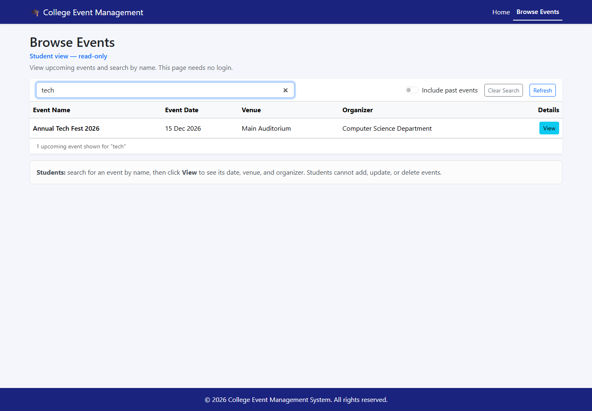

Event details loaded from `GET /api/events/:id`:

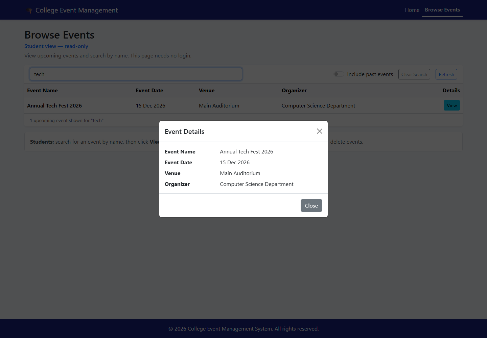

### Protected route

Opening `/manage` while logged out redirects to the coordinator login page:

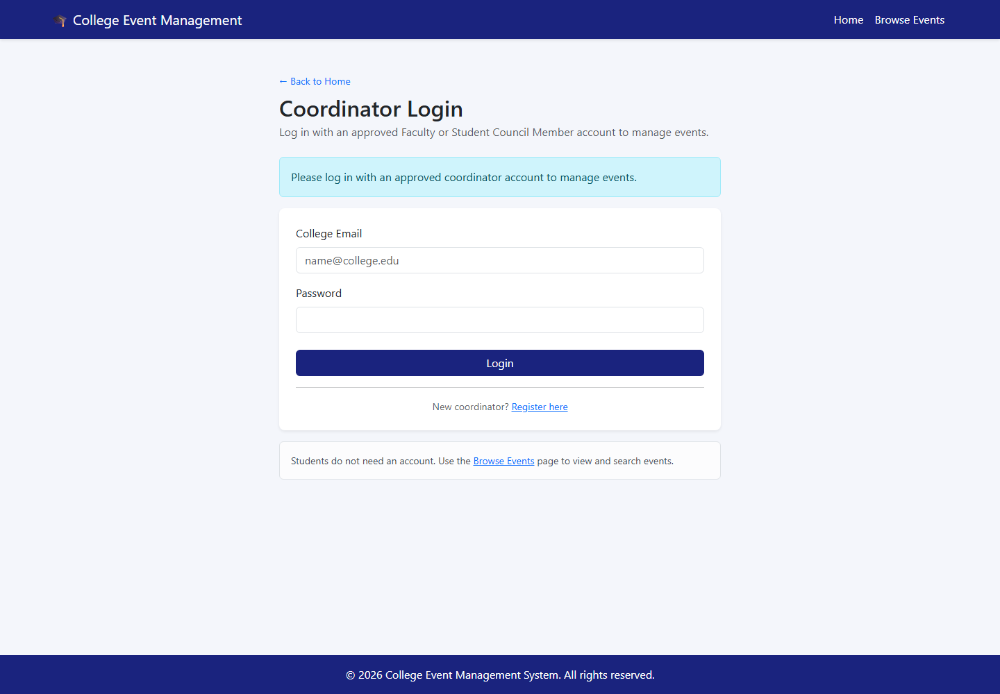

### Coordinator registration

The form shows Full Name, College Email, Designation, Department, Employee ID, Password, and Confirm
Password. The identifier field changes to Student Council ID for Student Council Members.


Registration creates a pending account and does not log the user in:

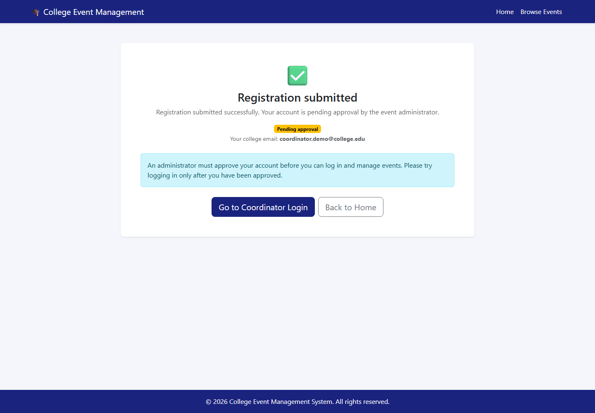

A pending account cannot log in:

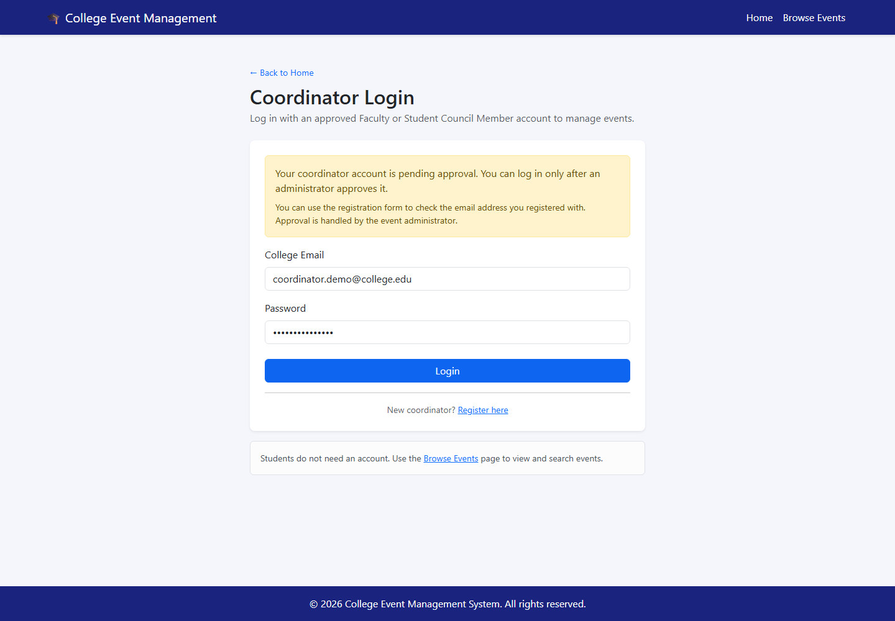

### Coordinator login and dashboard

Login for an approved coordinator:

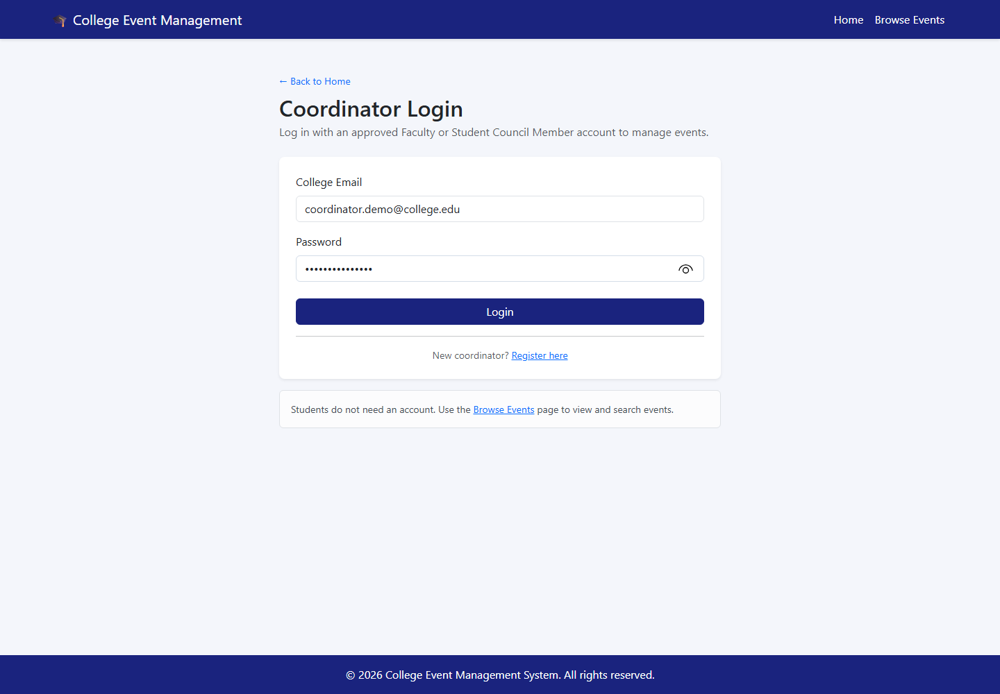

Protected dashboard with the approved coordinator's name:


### Add operation

Add form filled with event details:

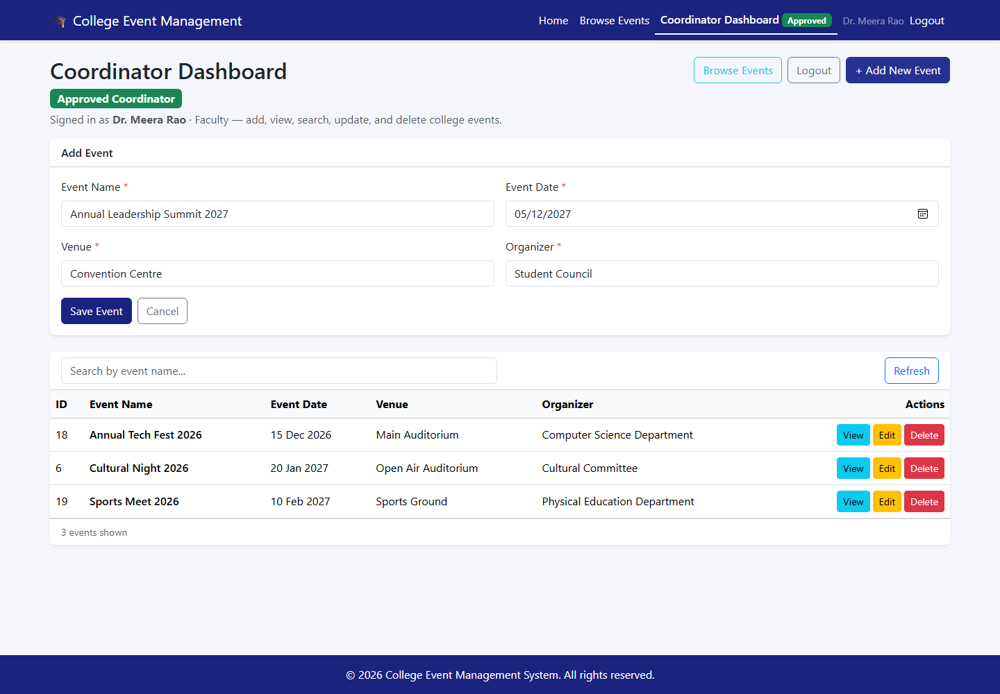

Event saved to MySQL and displayed in the table:

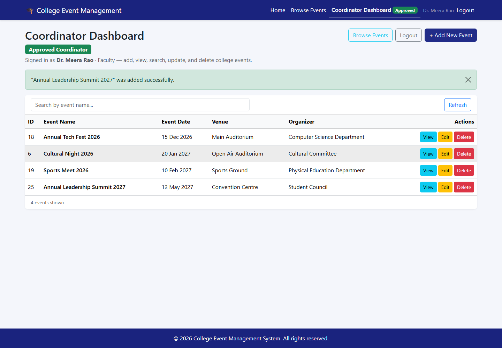

### Update operation

Editing the event:

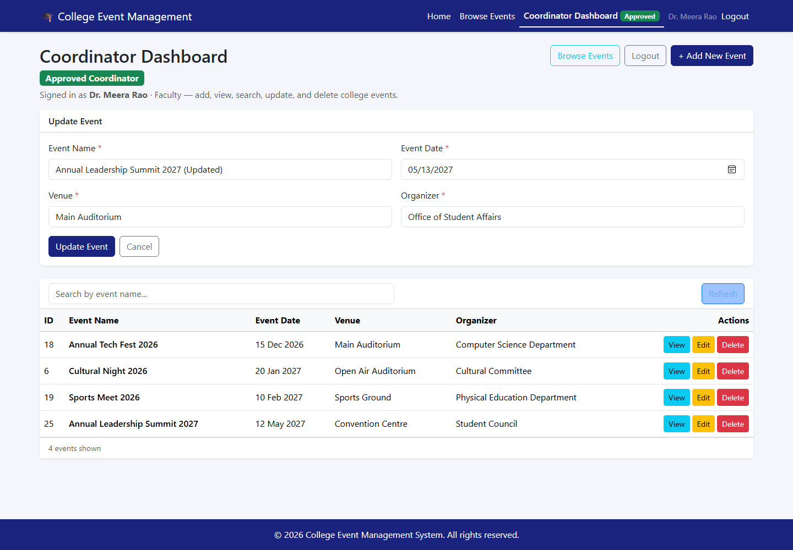

Updated values saved and shown in the table:

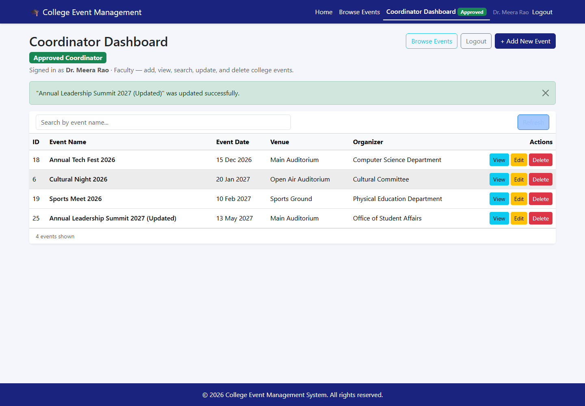

### Delete operation

Delete confirmation:

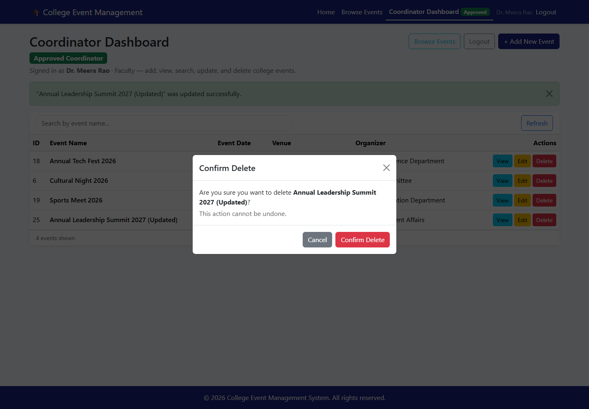

Event removed; the original events remain:

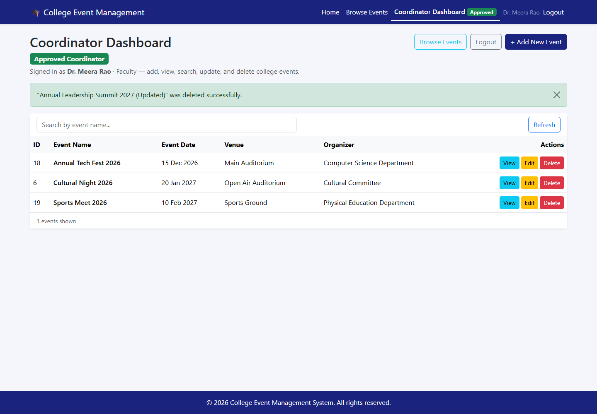

---

## GitHub Setup

This folder is prepared with a `.gitignore` that excludes `node_modules`, `.env`, build output, and
logs. Do **not** upload your real `.env` file or MySQL password.

### 1. Check Git and GitHub CLI

```powershell
git --version
gh --version
```

`gh` (GitHub CLI) is optional. You can also create the repository on the GitHub website.

### 2. Initialise the local repository

```powershell
cd C:\Users\shiva\CollegeEventManagement
git init
git add .
git status
```

Before committing, confirm that `backend/.env` and both `node_modules` folders are **not** listed.
If Git shows `backend/.env`, stop and check `.gitignore`.

Commit:

```powershell
git commit -m "Complete College Event Management System with React, Express, and MySQL"
```

### 3. Create and push the GitHub repository

**Option A — GitHub website**

1. Go to https://github.com/new.
2. Repository name: `college-event-management`.
3. Choose Public or Private.
4. Do **not** add a README, `.gitignore`, or license (they already exist locally).
5. Click **Create repository**.
6. Copy the repository URL shown by GitHub, then run:

```powershell
cd C:\Users\shiva\CollegeEventManagement
git branch -M main
git remote add origin https://github.com/YOUR_USERNAME/college-event-management.git
git push -u origin main
```

Replace `YOUR_USERNAME` with your GitHub username. GitHub may open a browser window to sign in.

**Option B — GitHub CLI**

```powershell
gh auth login
cd C:\Users\shiva\CollegeEventManagement
git branch -M main
gh repo create college-event-management --public --source . --remote origin --push
```

After pushing, open the repository page and confirm these are present:

- `README.md`
- `database.sql`
- `backend/` and `frontend/` source code
- `screenshots/` with all 16 images
- **No** `.env` file and **no** `node_modules` folder

> **Current status:** everything is committed locally only. No GitHub remote exists and nothing has
> been pushed or published. Run the commands above only when you are ready to publish, then replace
> the placeholder repository URL in this README.

---

## 2–3 Minute Demonstration Script

Practice this once before recording. Have the backend and frontend running and one pending
coordinator email available.

### 0:00–0:20 — Home page

- Open http://localhost:5173.
- Say: "This is the College Event Management System built with React, Express, and MySQL. The Home
  page has two separate areas: one for event coordinators and one for students."
- Read the description: **Discover college events and keep track of upcoming activities.**
- Point out **Coordinator Registration**, **Coordinator Login**, and **Browse Events**.

### 0:20–0:45 — Student browsing and restrictions

- Click **Browse Events**.
- Say: "Students can view upcoming events and search by name without an account. This page is
  read-only."
- Point out that there are no Add, Edit, or Delete buttons and no coordinator links.
- Type `tech` in the search box, click **View** on the result, and close the details modal.

### 0:45–1:10 — Registration becomes pending

- Return to Home and click **Coordinator Registration**.
- Fill in the form. Switch Designation to **Student Council Member** and back to **Faculty** to show
  that the identifier field changes.
- Submit the form and show the **Pending approval** screen.
- Try **Coordinator Login** with the same credentials. Say: "A pending coordinator cannot log in."

### 1:10–1:30 — Approve and log in

- In a terminal, run:
  ```powershell
  cd C:\Users\shiva\CollegeEventManagement\backend
  npm.cmd run approve -- coordinator@college.edu
  ```
- Return to the login page and sign in. The protected **Coordinator Dashboard** opens with the
  **Approved Coordinator** badge.
- Say: "Access is not just hidden in the UI. The backend checks the token and re-reads the approval
  status on every management request."

### 1:30–2:00 — Add and update

- Click **+ Add New Event** and enter a future event.
- Click **Save Event** and point out the success message and the new row.
- Click **Edit**, change the venue, and click **Update Event**. Point out the updated row.

### 2:00–2:20 — Delete and logout

- Click **Delete**, show the confirmation dialog, and click **Confirm Delete**.
- Show that the row is gone and the original events remain.
- Click **Logout**, then open `/manage` and show the redirect to login.

### 2:20–2:35 — Wrap-up

- Say: "Students get public read-only browsing, while only approved coordinators can change events.
  The rules are enforced by Express and MySQL, not only by the React interface."

---

## Design Notes and Future Improvements

### Why approval is enforced in the backend

Hiding buttons in React is not access control. This project therefore protects every write route in
Express with `requireApprovedCoordinator`, which:

1. Requires a `Bearer` JWT signed with `JWT_SECRET`.
2. Re-reads the coordinator row from MySQL.
3. Rejects the request unless `status = 'approved'`.

That means an old token stops working as soon as approval is revoked, and calling the API directly
with `curl` or PowerShell follows exactly the same rules as the UI.

### Deliberate scope choices

- **No student accounts.** Browsing is public and read-only, as requested.
- **No admin web UI.** Approval is a local command (`npm run approve -- <email>`). An admin page would
  need its own role and authentication design.
- **Registration is limited by designation.** Only Faculty and Student Council Member are accepted,
  and the database check constraint enforces the matching identifier type.
- **Passwords are hashed with bcrypt** (cost 12). The API never returns `password_hash`.

### Possible future improvements

1. **Admin approval UI** with an audit trail of who approved each coordinator.
2. **Email verification** for college addresses and password-reset emails.
3. **Refresh tokens** or server-side sessions so logout can revoke tokens immediately everywhere.
4. **Pagination, date filters, and a calendar view** for larger event lists.
5. **Event capacity, registration, and notifications** if student accounts are added later.
6. **Automated tests** (API integration tests and browser tests) in CI.

---

## Troubleshooting

### `npm.ps1 cannot be loaded` / scripts are blocked

Use `npm.cmd` instead of `npm`:

```powershell
npm.cmd install
npm.cmd run dev
```

### `Access denied for user 'root'@'localhost'`

- The password in `backend/.env` is wrong or still `your_password`.
- Update `DB_PASSWORD` in `backend/.env`, save, and restart the backend.
- Do not share your password in screenshots, chat, or GitHub.

### Frontend shows "Unable to load events"

- Make sure the backend terminal is still running.
- Open http://localhost:5000/api/health; it should return
  `{"status":"ok","message":"Database connected"}`.
- Make sure the frontend is running on port `5173`.

### `ECONNREFUSED` or backend does not start

- Confirm MySQL is running:
  ```powershell
  Get-Service MySQL80
  ```
- Start it if needed:
  ```powershell
  Start-Service MySQL80
  ```
  (Run PowerShell as Administrator if required.)

### Port already in use

Check which process is using the port:

```powershell
Get-NetTCPConnection -LocalPort 5000 -ErrorAction SilentlyContinue
Get-NetTCPConnection -LocalPort 5173 -ErrorAction SilentlyContinue
```

Stop the old process or change `PORT` in `backend/.env` and `VITE_API_BASE_URL` in
`frontend/.env`.

### MySQL command not found

Use the full path:

```text
C:\Program Files\MySQL\MySQL Server 8.0\bin\mysql.exe
```

### New event date is rejected

The API and form reject dates in the past when **adding** a new event. Existing events can still be
edited with an older date if needed.

### Table is empty

This is expected after a fresh database setup. Add an event from the **Coordinator Dashboard** after
logging in with an approved coordinator account.

### Coordinator login says "pending approval"

The account exists but has not been approved. Approve it locally:

```powershell
cd C:\Users\shiva\CollegeEventManagement\backend
npm.cmd run approve -- your-email@college.edu
```

Then log in again. No backend restart is required.

### `401` on add, update, or delete

- The request has no token, or the token is invalid or expired.
- The frontend attaches the token automatically; API clients must send
  `Authorization: Bearer <token>`.
- Log in again to obtain a fresh token. If you changed `JWT_SECRET`, all existing tokens are
  invalid.

### `403` after previously working as a coordinator

The account's `status` in MySQL is no longer `approved`. Check it:

```powershell
& "C:\Program Files\MySQL\MySQL Server 8.0\bin\mysql.exe" -u root -p -e "USE college_events; SELECT id, email, status FROM coordinators ORDER BY id;"
```

Re-approve with the CLI, then log in again.

### "Server authentication is not configured"

`JWT_SECRET` is missing from `backend/.env`. Add a long random value and restart the backend:

```powershell
node -e "console.log(require('crypto').randomBytes(48).toString('hex'))"
```

### Logged out unexpectedly / redirected to login

This is expected when a stored token is missing, expired, or rejected. The frontend verifies the
session with `GET /api/coordinators/me` on load and clears invalid sessions.

### `Cannot find module 'bcryptjs'` or `'jsonwebtoken'`

Backend dependencies are missing. Run:

```powershell
cd C:\Users\shiva\CollegeEventManagement\backend
npm.cmd install
```

---

## Security Notes

- All SQL statements use `?` placeholders through `mysql2`; user input is never concatenated into SQL.
- The backend validates every field, including email format, designation, identifier rules, password
  length and confirmation, date format, real calendar dates, and maximum lengths.
- Passwords are hashed with **bcrypt** (cost factor 12). Plain-text passwords are never stored or
  returned by the API.
- Coordinator sessions use **JWT** signed with `JWT_SECRET`, with an expiry set by `JWT_EXPIRES_IN`.
- `JWT_SECRET`, the MySQL password, and all database credentials live in `backend/.env`, which is
  excluded from Git. `.env.example` contains placeholders only.
- Every protected request re-reads `coordinators.status` from MySQL, so approval is checked on each
  call rather than trusted from the token.
- Missing, invalid, or expired tokens receive `401`; pending or rejected accounts receive `403`,
  even if they hold an older token.
- Public `GET` event endpoints remain open for students. `POST`, `PUT`, and `DELETE` require an
  approved coordinator.
- Role separation is enforced by Express, not only by hiding UI controls.
- `node_modules`, build output, logs, and `.env` files are excluded from version control.
- Approval is intentionally a local administrator action; there is no public admin endpoint.
- For production use, add HTTPS, rate limiting, email verification, and a token revocation strategy.
  See [Design Notes and Future Improvements](#design-notes-and-future-improvements).
