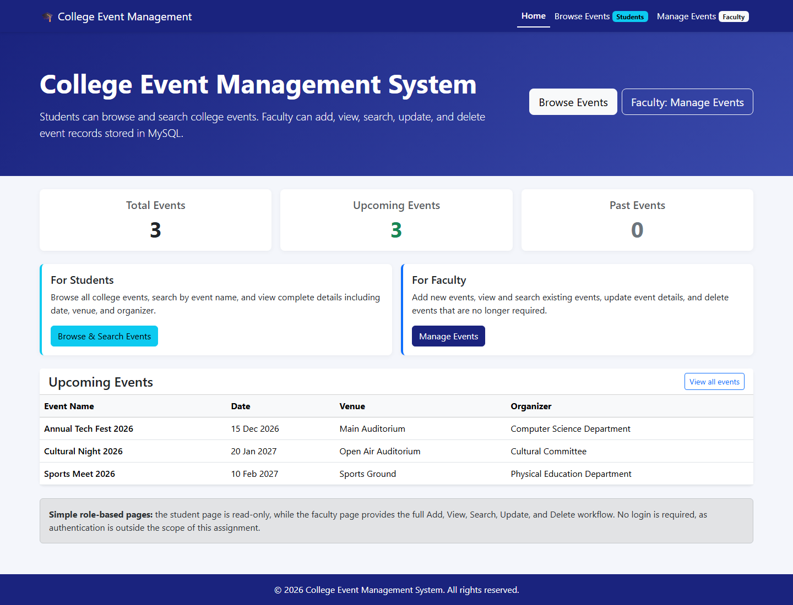
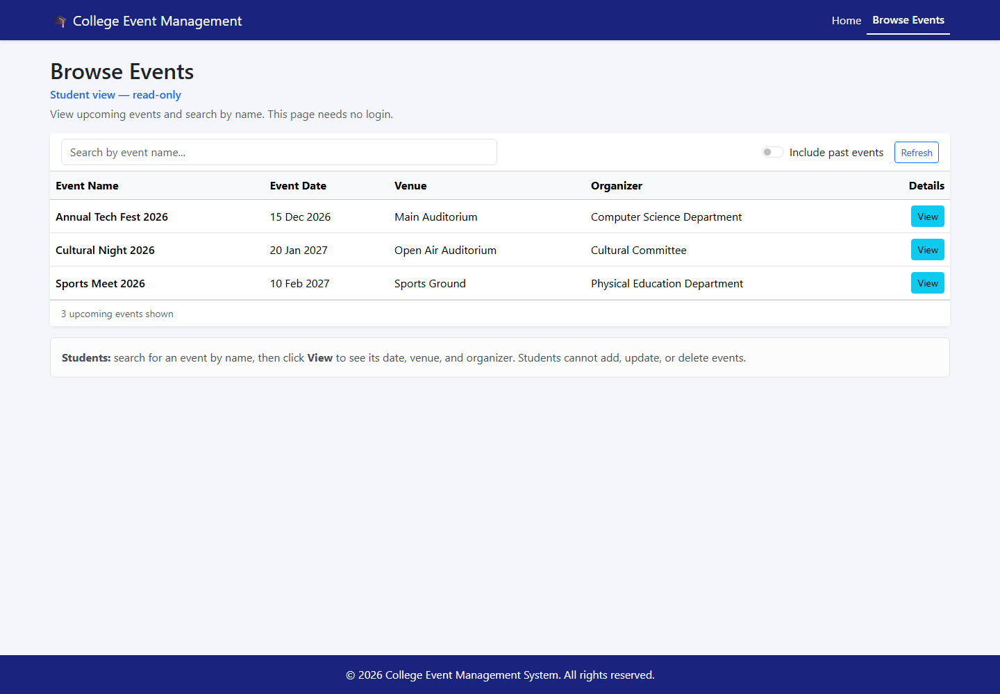
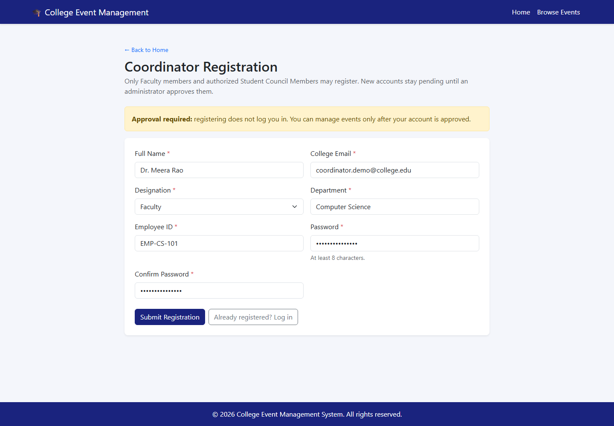
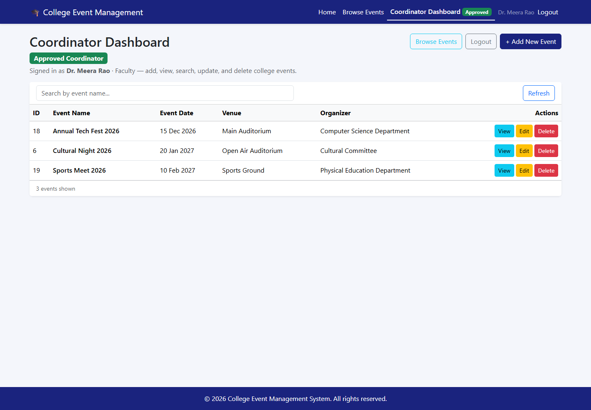

# College Event Management System

A full-stack web application for managing college events such as
seminars, workshops, cultural programmes, technical competitions, and
hackathons. Students can browse events publicly, while approved event
coordinators can manage event records.

## Features

### Students

-   Browse upcoming college events without creating an account.
-   Search events by name.
-   View event details.
-   Access a public, read-only events page.

### Event coordinators

-   Register as Faculty or Student Council Member.
-   Wait for administrator approval before logging in.
-   Access a protected dashboard after approval.
-   Add, view, search, update, and delete events.
-   Log out of the coordinator session.

### Security

-   Passwords are stored as bcrypt hashes, not plain text.
-   Coordinator sessions use JSON Web Tokens (JWT).
-   The backend checks the coordinator's current approval status on
    protected requests.
-   Public event-reading routes are separate from protected
    event-management routes.
-   SQL queries use parameters to help prevent SQL injection.
-   Real database credentials and the JWT secret belong in
    `backend/.env`, not in Git.

## Technologies

  -----------------------------------------------------------------------
  Layer                               Technologies
  ----------------------------------- -----------------------------------
  Frontend                            React, JavaScript (JSX), Bootstrap,
                                      React Router, Axios, Vite

  Backend                             Node.js, Express, mysql2, dotenv,
                                      cors, bcryptjs, jsonwebtoken

  Database                            MySQL

  Tools                               npm, Git, GitHub
  -----------------------------------------------------------------------

## Project structure

``` text
CollegeEventManagement/
├── backend/
│   ├── config/
│   ├── controllers/
│   ├── middleware/
│   ├── routes/
│   ├── scripts/
│   ├── services/
│   ├── .env.example
│   ├── package.json
│   └── server.js
├── frontend/
│   ├── src/
│   │   ├── components/
│   │   ├── context/
│   │   ├── pages/
│   │   ├── services/
│   │   ├── styles/
│   │   └── utils/
│   ├── .env.example
│   ├── package.json
│   └── vite.config.js
├── screenshots/
├── database.sql
└── README.md
```

## Prerequisites

Install: - Node.js 18 or newer - npm - MySQL Server - Git (if you want
to clone or push the repository)

Check the installed versions in PowerShell:

``` powershell
node --version
npm.cmd --version
git --version
```

If PowerShell blocks `npm.ps1`, use `npm.cmd` in the commands below.

## Installation

Open PowerShell in the project folder (the folder that contains
`backend`, `frontend`, and `database.sql`), then install the dependencies:

``` powershell
cd backend
npm.cmd install
cd ..\frontend
npm.cmd install
```

## Database setup

The application uses a MySQL database named `college_events`. To set it
up, use MySQL Workbench:

1. Open MySQL Workbench and connect to your local MySQL server.
2. Open the `database.sql` file from this project folder.
3. Click the lightning-bolt button to execute the script.
4. Refresh the Schemas panel and check that `college_events` appears.

Review `database.sql` before running it against a database containing
important data.

## Environment configuration

### Backend

From the project folder, create a local environment file:

``` powershell
cd backend
Copy-Item .env.example .env
notepad .env
```

Set the values required by your backend configuration. Typical settings
include:

``` env
DB_HOST=localhost
DB_PORT=3306
DB_USER=root
DB_PASSWORD=your_mysql_password
DB_NAME=college_events
PORT=5000
JWT_SECRET=replace_with_a_long_random_secret
JWT_EXPIRES_IN=8h
```

Use your own MySQL password and a long, random JWT secret. Do not commit
`.env` or share its contents. The `.env.example` file should contain
placeholders only.

You can generate a random secret with:

``` powershell
node -e "console.log(require('crypto').randomBytes(48).toString('hex'))"
```

### Frontend

The local frontend normally sends API requests to
`http://localhost:5000/api`. If the project uses `VITE_API_BASE_URL`,
configure it in `frontend/.env` as needed:

``` env
VITE_API_BASE_URL=http://localhost:5000/api
```

## Running the application

Run the backend and frontend in two separate PowerShell terminals during
development.

### Terminal 1: Backend

``` powershell
cd backend
npm.cmd run dev
```

If the `dev` script is not available, check the scripts listed in
`backend/package.json`; `npm.cmd start` may be available instead.

The backend is expected to use port `5000`.

### Terminal 2: Frontend

``` powershell
cd frontend
npm.cmd run dev
```

Vite normally serves the frontend at `http://localhost:5173`.

## Local URLs

  ----------------------------------------------------------------------------------
  Page or service                     URL
  ----------------------------------- ----------------------------------------------
  Home page                           `http://localhost:5173`

  Student events                      `http://localhost:5173/events`

  Coordinator registration            `http://localhost:5173/coordinator/register`

  Coordinator login                   `http://localhost:5173/coordinator/login`

  Coordinator dashboard               `http://localhost:5173/manage`

  Backend API                         `http://localhost:5000/api`

  Backend health check                `http://localhost:5000/api/health`
  ----------------------------------------------------------------------------------

The dashboard requires an approved coordinator account.

## API overview

Base URL: `http://localhost:5000/api`

  ---------------------------------------------------------------------------------
  Method            Endpoint                   Access            Purpose
  ----------------- -------------------------- ----------------- ------------------
  `GET`             `/health`                  Public            Check
                                                                 backend/database
                                                                 status

  `GET`             `/events`                  Public            Retrieve events

  `GET`             `/events?search=tech`      Public            Search events

  `GET`             `/events/:id`              Public            Retrieve one event

  `POST`            `/coordinators/register`   Public            Register a
                                                                 coordinator

  `POST`            `/coordinators/login`      Public            Log in an approved
                                                                 coordinator

  `GET`             `/coordinators/me`         Approved          Get the current
                                               coordinator       coordinator

  `POST`            `/events`                  Approved          Create an event
                                               coordinator       

  `PUT`             `/events/:id`              Approved          Update an event
                                               coordinator       

  `DELETE`          `/events/:id`              Approved          Delete an event
                                               coordinator       
  ---------------------------------------------------------------------------------

Protected requests must include a bearer token:

``` http
Authorization: Bearer <token>
```

The exact coordinator-authorization command is defined by the scripts in
`backend/package.json` and `backend/scripts/`. Check those files before
running an approval or authorization command, as script names can change
between versions.

## Testing checklist

1.  Open the home page and confirm the Student and Event Coordinator
    sections appear.
2.  Browse events without logging in and test search and event details.
3.  Confirm the student page does not offer event-management controls.
4.  Register a coordinator and verify that the account remains pending
    until approved.
5.  Verify that a pending coordinator cannot log in.
6.  Approve a test coordinator using the current local authorization
    procedure.
7.  Log in and test creating, viewing, searching, updating, and deleting
    an event.
8.  Log out and confirm the protected dashboard redirects to login.
9.  Check that event-management API requests without a valid
    approved-coordinator token are rejected.

## Screenshots

The screenshots below show the main parts of the application. These are
optional documentation images; the application does not depend on them.

### Home page



### Student event browsing



### Coordinator registration



### Coordinator dashboard



## Troubleshooting

### PowerShell says scripts are disabled

Use `npm.cmd` instead of `npm`, for example:

``` powershell
npm.cmd install
npm.cmd run dev
```

### The frontend cannot load events

-   Confirm the backend is running.
-   Open `http://localhost:5000/api/health`.
-   Confirm the frontend API base URL points to
    `http://localhost:5000/api`.

### Port 5000 or 5173 is already in use

A server may already be running in another terminal. Check the existing
terminal before starting another copy. If necessary, inspect the process
using the port and stop only the process you recognise as belonging to
this project.

### MySQL connection fails

-   Confirm the MySQL service is running.
-   Check `DB_HOST`, `DB_PORT`, `DB_USER`, `DB_PASSWORD`, and `DB_NAME`
    in `backend/.env`.
-   Restart the backend after changing environment variables.
-   Never paste your real password into a public issue or commit it to
    GitHub.

### Coordinator login says approval is pending

The account has not yet been approved. Follow the current authorization
procedure implemented in `backend/scripts/` and documented by the
backend package scripts.

## Security notes

-   Keep `.env` files, database passwords, and JWT secrets out of
    GitHub.
-   Use strong passwords and a unique random JWT secret.
-   Protected API routes must enforce authorization on the backend;
    hiding frontend buttons is not sufficient.
-   Use HTTPS, rate limiting, and a suitable token-revocation/session
    strategy before deploying the application publicly.
-   Use sample or dummy data in screenshots and example SQL files; do
    not publish real personal information.

## Future improvements

-   Administrator interface and audit log for coordinator approvals.
-   College email verification and password-reset flow.
-   Event calendar, pagination, and date filters.
-   Automated API and browser tests.
-   Notifications and event registration if student accounts are added
    later.
