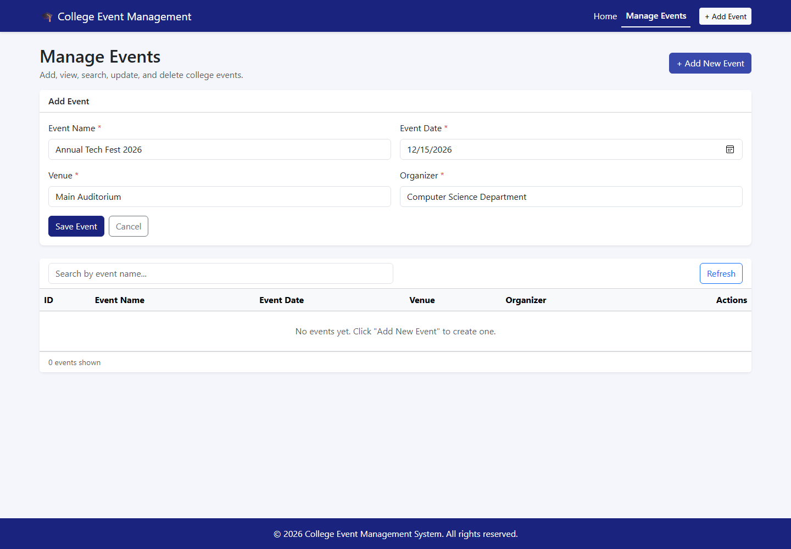
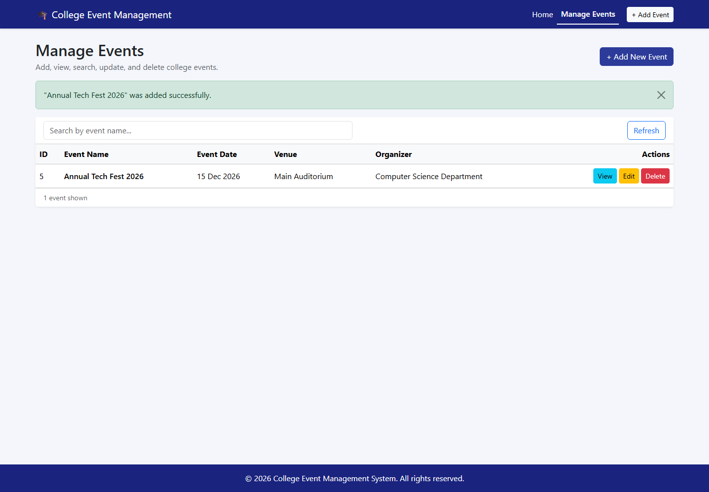
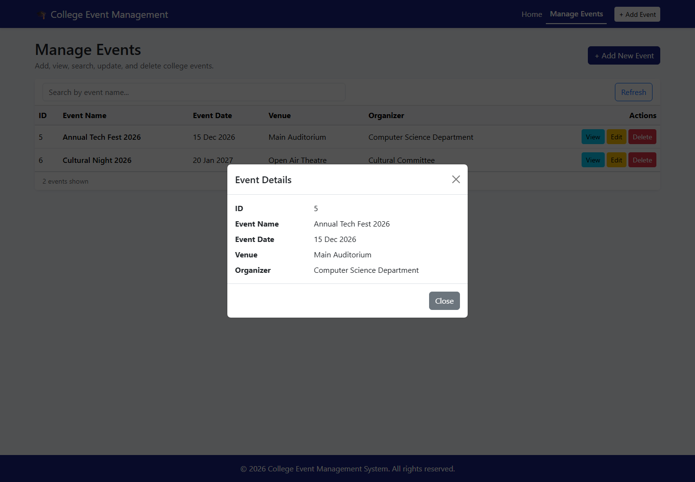
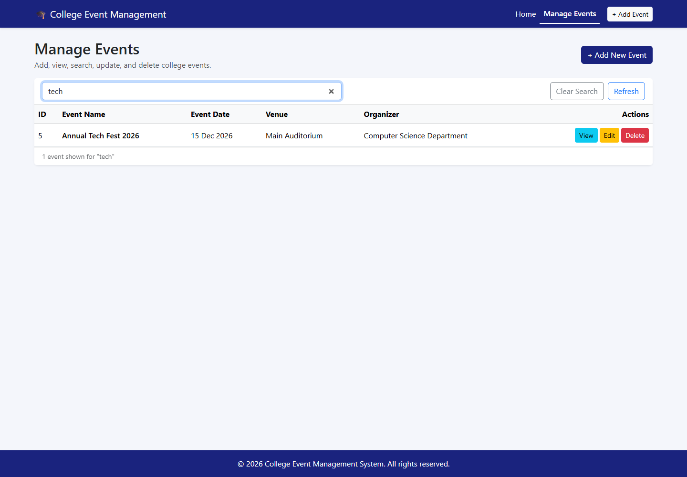
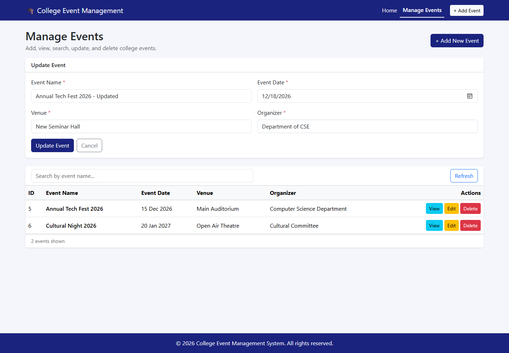
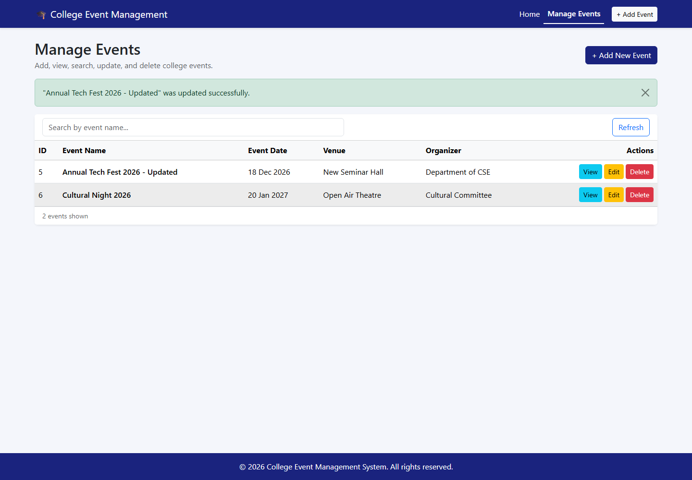
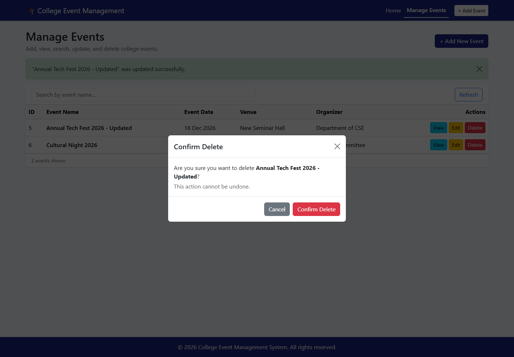
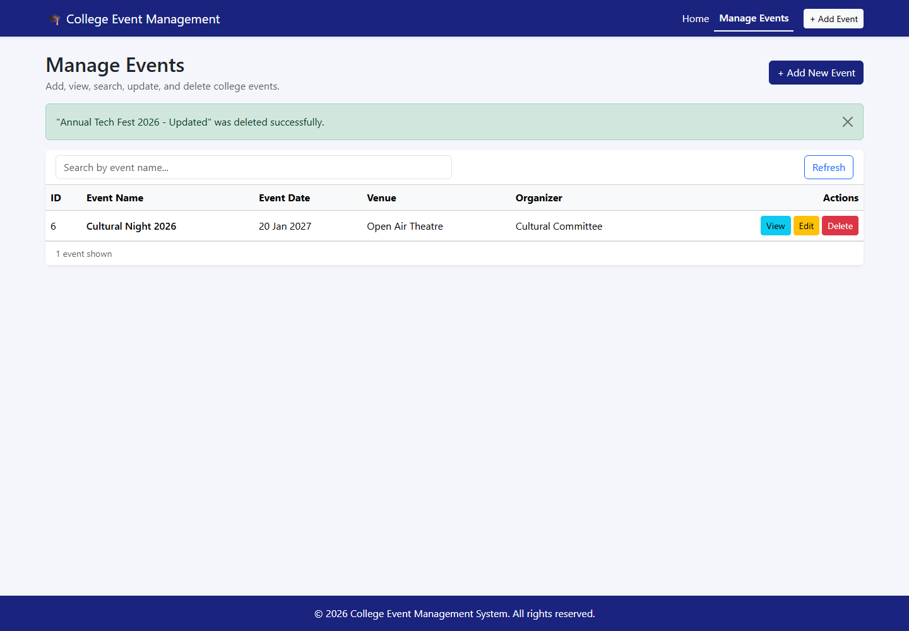
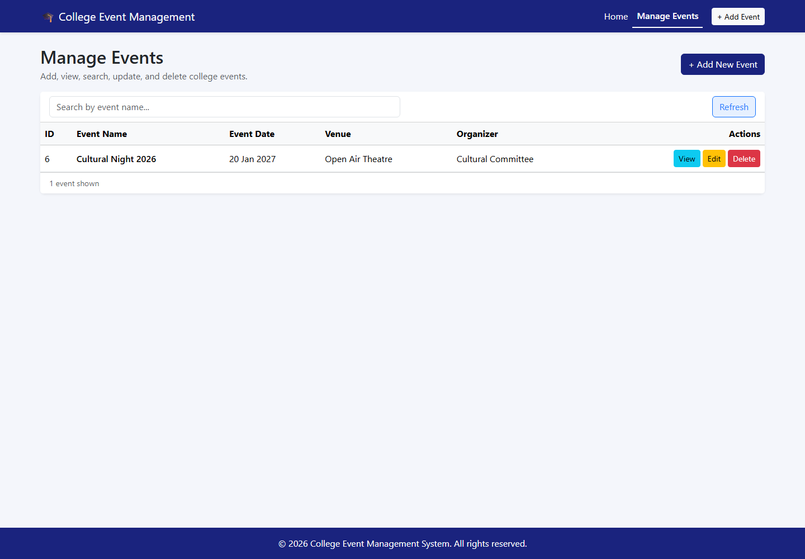

# College Event Management System

A full-stack web application for managing college events such as seminars, workshops, cultural
programs, technical competitions, and hackathons. Events are stored in MySQL and managed through a
React + Bootstrap interface that talks to a Node.js + Express REST API.

The application supports the complete CRUD workflow: **Add, View, Search, Update, and Delete**.

---

## Table of Contents

1. [Features](#features)
2. [Technologies Used](#technologies-used)
3. [Project Structure](#project-structure)
4. [Prerequisites](#prerequisites)
5. [Installation](#installation)
6. [MySQL Database Setup](#mysql-database-setup)
7. [Environment Variables](#environment-variables)
8. [Running the Application](#running-the-application)
9. [Local URLs](#local-urls)
10. [API Endpoints](#api-endpoints)
11. [Testing the Five CRUD Operations](#testing-the-five-crud-operations)
12. [Screenshots](#screenshots)
13. [GitHub Setup](#github-setup)
14. [2–3 Minute Demonstration Script](#23-minute-demonstration-script)
15. [Troubleshooting](#troubleshooting)

---

## Features

- Responsive **Home page** with event statistics and the next five upcoming events
- **Manage Events** page with a table of all events
- **Add** a new event with Event Name, Event Date, Venue, and Organizer
- **View** complete details of a single event in a modal
- **Search** events by name using a case-insensitive partial match
- **Update** any event and immediately see the saved values
- **Delete** an event after a confirmation prompt
- Frontend validation with clear inline field errors
- Server-side validation with appropriate HTTP status codes
- Success and error alerts for every operation
- Parameterized SQL queries to prevent SQL injection
- MySQL persistence with auto-increment IDs and indexes
- Credentials loaded from environment variables and excluded from Git

---

## Technologies Used

| Layer | Technology |
|---|---|
| Frontend | React 18, JavaScript (JSX), Bootstrap 5, React Router 6, Axios, Vite |
| Backend | Node.js, Express.js 4, mysql2, dotenv, cors |
| Database | MySQL Server 8.0 |
| Tooling | npm, Git, GitHub |

---

## Project Structure

```text
CollegeEventManagement/
├── backend/
│   ├── config/
│   │   └── db.js                 # MySQL connection pool
│   ├── controllers/
│   │   └── eventController.js    # Validation, request handling, status codes
│   ├── routes/
│   │   └── eventRoutes.js        # REST API routes
│   ├── services/
│   │   └── eventService.js       # Parameterized SQL queries
│   ├── .env.example              # Placeholder environment variables
│   ├── package.json
│   └── server.js                 # Express app entry point
├── frontend/
│   ├── src/
│   │   ├── components/
│   │   │   ├── Footer.jsx
│   │   │   └── Navbar.jsx
│   │   ├── pages/
│   │   │   ├── Home.jsx
│   │   │   └── ManageEvents.jsx
│   │   ├── services/
│   │   │   └── api.js            # Axios API client
│   │   ├── styles/
│   │   │   └── custom.css
│   │   ├── utils/
│   │   │   └── formatDate.js
│   │   ├── App.jsx
│   │   └── main.jsx
│   ├── .env.example
│   ├── index.html
│   ├── package.json
│   └── vite.config.js
├── screenshots/                  # Genuine screenshots of the running app
├── database.sql                  # Creates the database and events table
├── README.md
└── .gitignore
```

---

## Prerequisites

Install these before running the project:

- **Node.js** 18 or newer (this project was tested with Node.js 24)
- **npm** (installed with Node.js)
- **MySQL Server 8.0** (installed and running as the `MySQL80` Windows service)
- **Git** (for GitHub submission)
- A code editor such as VS Code (optional)

Check your versions in PowerShell:

```powershell
node --version
npm.cmd --version
git --version
```

> **PowerShell note:** If `npm` is blocked by the `npm.ps1` execution policy, always use
> `npm.cmd` instead, as shown in this README.

---

## Installation

### 1. Open the project folder

```powershell
cd C:\Users\shiva\CollegeEventManagement
```

### 2. Install backend dependencies

```powershell
cd backend
npm.cmd install
```

### 3. Install frontend dependencies

```powershell
cd ..\frontend
npm.cmd install
```

---

## MySQL Database Setup

The project uses a database named **`college_events`** with one table named **`events`**.

### Table structure

| Column | Type | Constraints |
|---|---|---|
| `id` | `INT` | Primary key, auto-increment |
| `event_name` | `VARCHAR(150)` | Not null, non-blank check |
| `event_date` | `DATE` | Not null |
| `venue` | `VARCHAR(150)` | Not null, non-blank check |
| `organizer` | `VARCHAR(150)` | Not null, non-blank check |

Indexes: `idx_event_name` on `event_name`, `idx_event_date` on `event_date`.

### Option A — Run from PowerShell (recommended)

MySQL is installed at
`C:\Program Files\MySQL\MySQL Server 8.0\bin\mysql.exe`. Because `mysql` may not be on your
`PATH`, use the full path:

```powershell
& "C:\Program Files\MySQL\MySQL Server 8.0\bin\mysql.exe" -u root -p -e "source C:/Users/shiva/CollegeEventManagement/database.sql"
```

You will be prompted for your MySQL root password. The password is not stored in the command.

Verify the table was created:

```powershell
& "C:\Program Files\MySQL\MySQL Server 8.0\bin\mysql.exe" -u root -p -e "USE college_events; SHOW TABLES; DESCRIBE events;"
```

Expected result: a table named `events` with the five columns listed above.

> **PowerShell users:** do not use `mysql ... < database.sql`. PowerShell does not support the
> `<` redirection operator. Use the `-e "source ..."` command above, or use `cmd /c`.

### Option B — Run in MySQL Workbench

1. Open **MySQL Workbench** and connect to your local MySQL instance.
2. Select **File → Open SQL Script…** and choose
   `C:\Users\shiva\CollegeEventManagement\database.sql`.
3. Click the **Execute** button (lightning icon).
4. In the **Schemas** panel, click the refresh icon.
5. Expand **`college_events` → Tables** and confirm that **`events`** exists.

The script uses `CREATE DATABASE IF NOT EXISTS` and `CREATE TABLE IF NOT EXISTS`, so it is safe to
run more than once. It does not delete existing data.

---

## Environment Variables

### Backend

Copy the example file and edit it:

```powershell
cd C:\Users\shiva\CollegeEventManagement\backend
Copy-Item .env.example .env
notepad .env
```

Set your real MySQL password:

```env
DB_HOST=localhost
DB_PORT=3306
DB_USER=root
DB_PASSWORD=your_mysql_password
DB_NAME=college_events
PORT=5000
```

- Replace `your_mysql_password` with your actual password.
- If the password contains spaces, `#`, or quotes, wrap it in double quotes:
  `DB_PASSWORD="my password"`.
- **Never commit `.env` to GitHub.** It is already listed in `.gitignore`.
- `.env.example` contains placeholders only and is safe to commit.

### Frontend

The default API URL is `http://localhost:5000/api`, so no frontend `.env` file is required for local
development. To override it, copy the example file:

```powershell
cd C:\Users\shiva\CollegeEventManagement\frontend
Copy-Item .env.example .env
```

```env
VITE_API_BASE_URL=http://localhost:5000/api
```

---

## Running the Application

You need **two PowerShell terminals**: one for the backend and one for the frontend.

### Terminal 1 — Backend

```powershell
cd C:\Users\shiva\CollegeEventManagement\backend
npm.cmd run dev
```

Expected output:

```text
Server running on port 5000
Health check: http://localhost:5000/api/health
```

To run without nodemon, use `npm.cmd start`.

### Terminal 2 — Frontend

```powershell
cd C:\Users\shiva\CollegeEventManagement\frontend
npm.cmd run dev
```

Expected output includes:

```text
VITE ready
Local: http://localhost:5173/
```

### Production build check (optional)

```powershell
cd C:\Users\shiva\CollegeEventManagement\frontend
npm.cmd run build
npm.cmd run preview
```

---

## Local URLs

| Service | URL |
|---|---|
| Frontend (Vite dev server) | http://localhost:5173 |
| Manage Events page | http://localhost:5173/manage |
| Backend API | http://localhost:5000/api |
| Health check | http://localhost:5000/api/health |

The frontend also works when opened through `http://127.0.0.1:5173`; the backend allows both
`localhost` and `127.0.0.1` origins.

---

## API Endpoints

Base URL: `http://localhost:5000/api`

| Method | Endpoint | Purpose | Success status |
|---|---|---|---|
| `GET` | `/health` | Check server and database connection | `200` |
| `GET` | `/events` | Get all events | `200` |
| `GET` | `/events?search=tech` | Search events by name (partial, case-insensitive) | `200` |
| `GET` | `/events/search?q=tech` | Dedicated search endpoint | `200` |
| `GET` | `/events/:id` | Get a single event | `200` |
| `POST` | `/events` | Add a new event | `201` |
| `PUT` | `/events/:id` | Update an event | `200` |
| `DELETE` | `/events/:id` | Delete an event | `200` |

### Request body for Add/Update

```json
{
  "event_name": "Annual Tech Fest 2026",
  "event_date": "2026-12-15",
  "venue": "Main Auditorium",
  "organizer": "Computer Science Department"
}
```

### Error responses

| Status | Meaning |
|---|---|
| `400` | Invalid ID, missing field, invalid date, past date for a new event, or overlong text |
| `404` | Event not found or unknown route |
| `500` | Database or server error |

### PowerShell API examples

Get all events:

```powershell
Invoke-RestMethod -Uri "http://localhost:5000/api/events" -Method Get
```

Add an event:

```powershell
$body = @{
  event_name = "Annual Tech Fest 2026"
  event_date = "2026-12-15"
  venue      = "Main Auditorium"
  organizer  = "Computer Science Department"
} | ConvertTo-Json

Invoke-RestMethod -Uri "http://localhost:5000/api/events" -Method Post `
  -ContentType "application/json" -Body $body
```

Search events:

```powershell
Invoke-RestMethod -Uri "http://localhost:5000/api/events?search=tech" -Method Get
```

---

## Testing the Five CRUD Operations

Open http://localhost:5173/manage and follow these steps.

### 1. Add

1. Click **+ Add New Event**.
2. Enter:
   - Event Name: `Annual Tech Fest 2026`
   - Event Date: a future date, e.g. `2026-12-15`
   - Venue: `Main Auditorium`
   - Organizer: `Computer Science Department`
3. Click **Save Event**.
4. A green message should say **"Annual Tech Fest 2026" was added successfully.**
5. The new row appears in the table with an auto-generated ID.
6. Optional check: try submitting empty fields or a past date; inline errors should appear.

### 2. View

1. Find the event row.
2. Click **View**.
3. A modal shows the ID, event name, date, venue, and organizer.
4. Click **Close**.

### 3. Search

1. Type `tech` in the search box.
2. After a short delay, the table shows only matching events.
3. Click **Clear Search** to show all events again.

### 4. Update

1. Click **Edit** on the event.
2. Change the venue to `New Seminar Hall` and the organizer to `Department of CSE`.
3. Click **Update Event**.
4. A green message should say the event was updated successfully.
5. The table shows the new values.
6. Optional check: refresh the browser; the values remain because they are stored in MySQL.

### 5. Delete

1. Click **Delete** on the event.
2. Confirm the event name in the dialog.
3. Click **Confirm Delete**.
4. A green message should say the event was deleted successfully.
5. The row disappears from the table.
6. Optional check: refresh the browser; the row remains gone.

### Verify directly in MySQL

```powershell
& "C:\Program Files\MySQL\MySQL Server 8.0\bin\mysql.exe" -u root -p -e "USE college_events; SELECT * FROM events ORDER BY id;"
```

---

## Screenshots

All screenshots below were captured from the running application after real UI actions and verified
against the MySQL database.

### Home page


### Add operation

Form filled with event details:



Event added successfully and displayed in the table:



### View operation

Single event details loaded from `GET /api/events/:id`:



### Search operation

Searching for `tech` shows only the matching event:



### Update operation

Editing the event:



Updated values saved and shown in the table:



### Delete operation

Delete confirmation:



Event removed; the other event remains:



### Final table state



---

## GitHub Setup

This folder is prepared with a `.gitignore` that excludes `node_modules`, `.env`, build output, and
logs. Do **not** upload your real `.env` file or MySQL password.

### 1. Check Git and GitHub CLI

```powershell
git --version
gh --version
```

`gh` (GitHub CLI) is optional. You can also create the repository on the GitHub website.

### 2. Initialise the local repository

```powershell
cd C:\Users\shiva\CollegeEventManagement
git init
git add .
git status
```

Before committing, confirm that `backend/.env` and both `node_modules` folders are **not** listed.
If Git shows `backend/.env`, stop and check `.gitignore`.

Commit:

```powershell
git commit -m "Complete College Event Management System with React, Express, and MySQL"
```

### 3. Create and push the GitHub repository

**Option A — GitHub website**

1. Go to https://github.com/new.
2. Repository name: `college-event-management`.
3. Choose Public or Private.
4. Do **not** add a README, `.gitignore`, or license (they already exist locally).
5. Click **Create repository**.
6. Copy the repository URL shown by GitHub, then run:

```powershell
cd C:\Users\shiva\CollegeEventManagement
git branch -M main
git remote add origin https://github.com/YOUR_USERNAME/college-event-management.git
git push -u origin main
```

Replace `YOUR_USERNAME` with your GitHub username. GitHub may open a browser window to sign in.

**Option B — GitHub CLI**

```powershell
gh auth login
cd C:\Users\shiva\CollegeEventManagement
git branch -M main
gh repo create college-event-management --public --source . --remote origin --push
```

After pushing, open the repository page and confirm these are present:

- `README.md`
- `database.sql`
- `backend/` and `frontend/` source code
- `screenshots/` with all 10 images
- **No** `.env` file and **no** `node_modules` folder

> The project has not been uploaded anywhere automatically. The final repository URL depends on
> your GitHub account and must be added here after you create it.

---

## 2–3 Minute Demonstration Script

Practice this once before recording.

### 0:00–0:20 — Home page

- Open http://localhost:5173.
- Say: "This is the College Event Management System built with React, Express, and MySQL."
- Point out the total, upcoming, and past event counts and the upcoming events table.

### 0:20–0:50 — Add

- Click **Manage Events → + Add New Event**.
- Enter:
  - Event Name: `Annual Tech Fest 2026`
  - Date: `2026-12-15`
  - Venue: `Main Auditorium`
  - Organizer: `Computer Science Department`
- Click **Save Event**.
- Say: "The event was saved to MySQL and received an auto-generated ID."
- Point out the green success message and the new row.

### 0:50–1:05 — View

- Click **View** on the new row.
- Say: "This detail view is loaded from the single-event REST API."
- Close the modal.

### 1:05–1:25 — Search

- Type `tech` in the search box.
- Say: "Search is case-insensitive, so partial names work."
- Point out that only the matching event is displayed.
- Click **Clear Search**.

### 1:25–1:50 — Update

- Click **Edit**.
- Change the venue to `New Seminar Hall` and organizer to `Department of CSE`.
- Click **Update Event**.
- Say: "The updated values are saved in MySQL and shown in the table."

### 1:50–2:10 — Delete

- Click **Delete**.
- Show the confirmation dialog.
- Click **Confirm Delete**.
- Say: "The event is removed from the database and disappears from the table."

### 2:10–2:30 — Wrap-up

- Optionally run the MySQL check:
  ```powershell
  & "C:\Program Files\MySQL\MySQL Server 8.0\bin\mysql.exe" -u root -p -e "USE college_events; SELECT * FROM events;"
  ```
- Say: "This demonstrates complete CRUD functionality with React, Express, and MySQL."

---

## Troubleshooting

### `npm.ps1 cannot be loaded` / scripts are blocked

Use `npm.cmd` instead of `npm`:

```powershell
npm.cmd install
npm.cmd run dev
```

### `Access denied for user 'root'@'localhost'`

- The password in `backend/.env` is wrong or still `your_password`.
- Update `DB_PASSWORD` in `backend/.env`, save, and restart the backend.
- Do not share your password in screenshots, chat, or GitHub.

### Frontend shows "Unable to load events"

- Make sure the backend terminal is still running.
- Open http://localhost:5000/api/health; it should return
  `{"status":"ok","message":"Database connected"}`.
- Make sure the frontend is running on port `5173`.

### `ECONNREFUSED` or backend does not start

- Confirm MySQL is running:
  ```powershell
  Get-Service MySQL80
  ```
- Start it if needed:
  ```powershell
  Start-Service MySQL80
  ```
  (Run PowerShell as Administrator if required.)

### Port already in use

Check which process is using the port:

```powershell
Get-NetTCPConnection -LocalPort 5000 -ErrorAction SilentlyContinue
Get-NetTCPConnection -LocalPort 5173 -ErrorAction SilentlyContinue
```

Stop the old process or change `PORT` in `backend/.env` and `VITE_API_BASE_URL` in
`frontend/.env`.

### MySQL command not found

Use the full path:

```text
C:\Program Files\MySQL\MySQL Server 8.0\bin\mysql.exe
```

### New event date is rejected

The API and form reject dates in the past when **adding** a new event. Existing events can still be
edited with an older date if needed.

### Table is empty

This is expected after a fresh database setup. Add an event from the **Manage Events** page.

---

## Security Notes

- All SQL statements use `?` placeholders through `mysql2`; user input is never concatenated into SQL.
- The backend validates every field, including date format, real calendar dates, and maximum lengths.
- Passwords are loaded from `backend/.env`, which is excluded from Git.
- `.env.example` contains placeholders only.
- `node_modules`, build output, and logs are excluded from version control.
